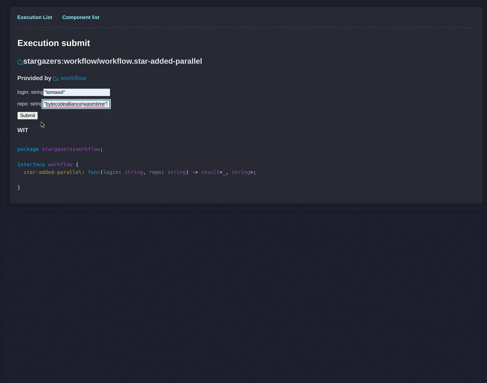

# Stargazers

A simple [Obelisk](https://github.com/obeli-sk/obelisk) webhook endpoint and a workflow
that monitors GitHub repositories. Every step is persisted and replayed during crash recovery.

## Workflow Code Example - `star-added`

```rust
fn star_added(login: String, repo: String) -> Result<(), String> {
    // 1. Persist the user giving a star to the project.
    let description = db::user::add_star_get_description(&login, &repo)?;
    if description.is_none() {
        // 2. Fetch the account info from GitHub.
        let info = github::account::account_info(&login)?;
        // 3. Fetch the prompt from the database.
        let settings_json = db::llm::get_settings_json()?;
        // 4. Generate the user's description.
        let description = llm::respond(&info, &settings_json)?;
        // 5. Persist the generated description.
        db::user::update_user_description(&login, &description)?;
    }
    Ok(())
}
```

Here is the complete [workflow source](./rust/workflow/src/lib.rs) and the
[WIT file](./workflow/wit-interface/stargazers_workflow/workflow.wit) describing the interface.

[](https://obeli.sk/screencast.webm)

## Deploying to Obelisk Cloud

Create a [Turso](https://turso.tech) database and an OpenAI API key (see
[Setting up the external services](#setting-up-the-external-services)), then:

```sh
git clone https://github.com/obeli-sk/demo-stargazers.git
cd demo-stargazers
obelisk cloud auth login
obelisk generate app-name   # picks a unique name and writes it to app.toml
obelisk cloud app push -a app.toml -d deployment.toml --fill
```

`--fill` prompts for `OPENAI_API_KEY`, `TURSO_TOKEN`, `TURSO_LOCATION` and `GITHUB_WEBHOOK_SECRET`.
GitHub requests go through the cloud's GitHub integration (`[cloud.integrations]` in `app.toml`),
so `GITHUB_TOKEN_STARGAZERS` is not needed.

The webhook is served at `https://<app>.obelisk.works/`; `obelisk cloud app status` prints the
endpoints. Point a GitHub repository webhook at it (only "Stars" events, the same
secret as `GITHUB_WEBHOOK_SECRET`), as described in the [webhook README](./rust/webhook/README.md).

## Setting up

### Setting up the external services
The activities require folowing values to be present as environment variables:
```sh
export GITHUB_TOKEN_STARGAZERS="..." # only for local runs; the cloud uses its GitHub integration
export OPENAI_API_KEY="..."
export TURSO_TOKEN="..."
export GITHUB_WEBHOOK_SECRET="some-secret"
export TURSO_LOCATION="https://[yourdb].turso.io"
```
`TURSO_LOCATION` is the database base URL including the scheme.
Optionally set `OPENAI_API_BASE_URL` (default `https://api.openai.com`) to use an OpenAI-compatible
endpoint, and `GITHUB_API_BASE_URL` (default `https://api.github.com`). Both base URLs may include
a path; the outbound HTTP rules allow only `<base>/v1/chat/completions` and `<base>/graphql`.

#### Turso activity
This activity is responsible for persistence of users and their generated descriptions.

Follow the prerequisites section of the [activity-db-turso README](./rust/activity/db/README.md).
The schema is migrated automatically when a deployment is activated.

Reimplementation in [JavaScript](./activity/db/) is available for comparison.

#### GitHub activity
This activity is used to find more information about the GitHub user who starred a configured repository.

Follow the prerequisites section of the [activity-github README](./rust/activity/github/README.md).

Reimplementation in [JavaScript](./activity/github/) is available for comparison.

#### OpenAI activity
Generates description based on user's repositories and organizations.

Follow the prerequisites section of the [activity-llm-openai README](./rust/activity/llm/README.md).

Reimplementations in [JavaScript](./activity/llm/) is available for comparison.

#### GitHub webhook endpoint
The webhook collects events sent by GitHub when a user stars one of the configured repositories, then triggers the workflow execution.

Follow the prerequisites section of the [webhook README](./rust/webhook/README.md).
Reimplementations in [JavaScript](./webhook/) is available for comparison.

#### Workflow
[Workflow](./rust/workflow/) orchestrates all the activities, is triggered by the webhook.

Reimplementations in [JavaScript](./workflow/) is available for comparison.

### Running

Set up the environment:
If [direnv](https://github.com/direnv/direnv) and [Nix](https://nixos.org/) are available:
```sh
cp .envrc-example .envrc
direnv allow
```
Otherwise install the following:
* [Obelisk](https://github.com/obeli-sk/obelisk)
* Optionally [Rust](https://rustup.rs/) for building the WASM components locally, version and other components are specified in [rust-toolchain.toml](./rust/rust-toolchain.toml)
* Optionally [Wasmtime](https://wasmtime.dev/) for integration testing of activities
* Optionally [Cloudflared](https://github.com/cloudflare/cloudflared) for exposing the webhook endpoint

The exact versions of dependencies used for development and testing are in [dev-deps.txt](./dev-deps.txt).

```sh
(cd rust && just serve)
```

Wait for the following lines in the process output:

```log
HTTP server `webui` is listening on http://127.0.0.1:8080
HTTP server `external` is listening on http://127.0.0.1:9090
HTTP server `internal` is listening on http://127.0.0.1:9091
API startup token: ...
Serving API requests at 127.0.0.1:5005
Obelisk <version> is ready
```

`--dev` prints the API startup token; clients such as the CLI send it via `OBELISK_API_TOKEN`.
The workflow can be started using the Web UI.
The webhook endpoint can be triggered using `curl` or by seting up the webhook
in a GitHub repo. See the [webhook documentation](rust/webhook/README.md) for details
on how to set up GitHub and a https tunnel to the local instance.

### Building the WASM components locally
The Rust deployment loads the components from the local `target` directory.
To build all the Rust components run
```sh
(cd rust && just serve)
```

The JS deployment is pure JavaScript, loaded directly by Obelisk without a build step:
```sh
obelisk server run --dev --app-config ./app.toml --deployment ./deployment.toml
```

Make sure to use tools and versions as specified in [dev-deps.txt](./dev-deps.txt).
